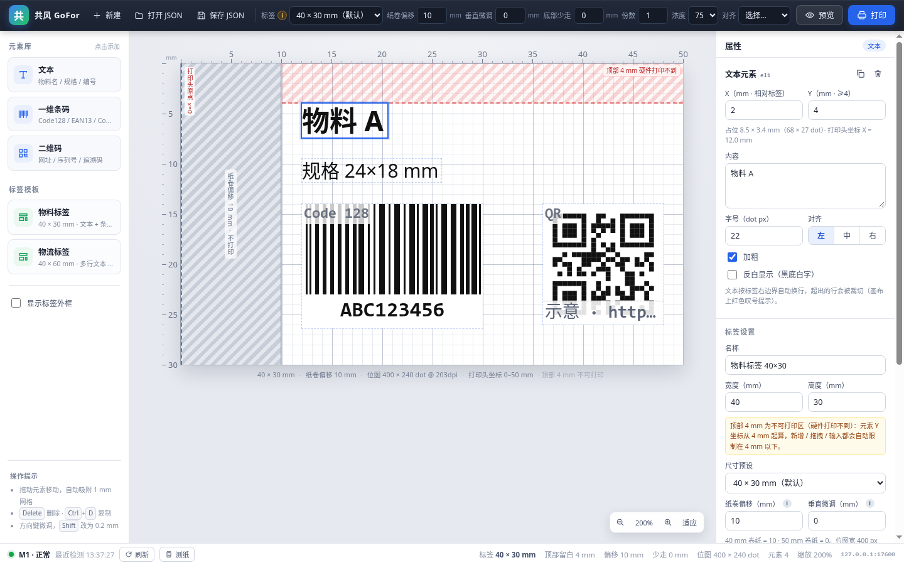

# 共风 GoFor Label Print · 标签设计器（ui/）

面向 **M1 标签打印机（203dpi）** 的开源 PC 标签设计器前端，仓库名 **label-print**，包名 `gofor-label-print`。
纯 **Vue 3 + Vite** 实现，画布用 DOM + CSS 绝对定位，**没有引入 konva / fabric / 任何需要编译的画布库**；
全部界面、图标、绘图逻辑均为原创。


- 左：元素库 / 标签模板 / 外框开关
- 中：打印头坐标 mm 标尺 + 1mm 网格；**左侧灰斜纹 = 纸卷偏移留白（10mm），红色虚线 = 打印头原点 x=0**
- 右：所选元素 / 标签属性（含纸卷偏移说明）+ 实时 spec JSON
- 顶：品牌、新建、打开/保存 JSON、标签预设、**纸卷偏移 / 垂直微调 / 底部少走**、份数、浓度、对齐、预览、打印
- 画布顶部 4mm 为**硬件不可打印区**（红色斜纹带），元素 Y 坐标从 4mm 起算
- 打印机：状态栏入口 → **扫描蓝牙 / 选择 / 连接**，记住上次选择（localStorage），预览/打印请求自动带 `addr`
- 底：打印机状态（型号 / 状态 / 错误）、刷新、测纸、**偏移与位图尺寸**

后端按「纸卷偏移 + 标签宽」渲染的真实 PNG 预览（40mm 纸 + 10mm 偏移 = 400 × 240 px）：


后端未启动时（不会白屏，给出错误与「重试」）：


---

标签顶部 4mm 是硬件打印不到的区域：画布用红色斜纹带标出，排版时元素 Y 坐标一律从 4mm 起算：



点击状态栏左侧的「当前打印机 / 选择打印机」芯片，可扫描蓝牙设备并连接（M1 高亮、记住上次选择）：


调整「垂直微调」时，标签区域顶部/底部会出现一条黄色虚线，提示可能被裁切的方向（不改变网格与元素坐标）：


底部少走（`trim_bottom_mm`）只影响打印：画布底部用红色斜纹带标出「不打印」区域，预览仍是完整 30mm 图像：


## 1. 快速开始

要求：Node.js ≥ 20.19（自测环境 Node v24.21.0 / npm 11.19.0）。

```bash
cd ui
npm install
npm run dev      # http://127.0.0.1:5173
```

生产构建与本地预览：

```bash
npm run build    # 产物在 ui/dist/
npm run preview  # http://127.0.0.1:4173
```

目录结构：

```
ui/
├── index.html            # 入口 HTML（中文 lang、原创 favicon）
├── package.json          # name: gofor-label-print，仅 vue + vite + @vitejs/plugin-vue
├── vite.config.js
├── docs/                 # 自测截图（editor / printer-dialog / top-margin / offset-y / trim-bottom / preview / offline-preview）
├── README.md
└── src/
    ├── main.js
    ├── App.vue           # 三栏布局 + 全局快捷键
    ├── api.js            # 后端 REST 封装（超时/错误友好化）
    ├── units.js          # mm↔dot、文字测量、按 mm 折行
    ├── label.js          # 文档模型、纸卷/垂直偏移、元素尺寸、spec 序列化/反序列化
    ├── styles.css        # 全部样式（深色工具条 + 浅色工作区）
    ├── components/
    │   ├── AppToolbar.vue      # 顶部工具条（含纸卷 / 垂直偏移输入）
    │   ├── ElementPalette.vue  # 左侧元素库/模板
    │   ├── LabelCanvas.vue     # 画布、打印头原点/偏移留白、mm 标尺、拖拽/缩放
    │   ├── LabelElement.vue    # 文本（逐行渲染）、条码/二维码 SVG 示意
    │   ├── PropertyPanel.vue   # 右侧属性面板 + spec JSON
    │   ├── StatusBar.vue       # 打印机状态栏
    │   ├── PrinterDialog.vue   # 打印机扫描 / 选择 / 连接弹窗
    │   ├── PreviewDialog.vue   # 预览弹窗
    │   ├── ToastStack.vue
    │   └── AppIcon.vue         # 原创 24×24 线稿图标
    └── stores/store.js   # reactive 全局状态 + 所有动作（无 pinia）
```

---

## 2. 纸卷偏移 / 垂直微调 / 底部少走 / 顶部禁区（关键硬件事实）

M1 的**纸筒挡板在左侧、纸筒仓宽 50mm**：装入 40mm 卷纸后，纸面相对打印头原点整体**右移 10mm**。
若不把偏移告诉后端，位图会从打印头 x=0 开始画，导致**左侧被裁、文字显示不全**。

| 规则 | 说明 |
| --- | --- |
| 字段 | 标签级 `offset_x_mm`（与 `width_mm` / `height_mm` / `border` / `density` 同级） |
| 默认值 | **10.0**（40mm 卷纸）；范围 **0 ~ 20**，步进 **0.5** |
| 常用取值 | **40mm 纸 = 10；50mm 纸 = 0**（挡板在左，纸卷靠左装入后右移） |
| 垂直微调 | 标签级 `offset_y_mm`：默认 **0**，范围 **-15 ~ 15**，步进 0.5；**正 = 内容下移、负 = 内容上移** |
| 底部少走 | 标签级 `trim_bottom_mm`：默认 **0**，范围 **0 ~ 5**，步进 0.5；固件不支持反向走纸，用「少走」等效回退，打印只下发 `(高度 − trim)` 行 |
| 顶部禁区 | 硬件打印不到顶部 **4mm**：元素 `y_mm` 最小 **4**，新增 / 拖拽 / 输入均自动夹到 ≥4；旧文件 y<4 自动下移；画布顶部红色斜纹带标出 |
| 输入位置 | 顶部工具条「纸卷偏移 / 垂直微调 / 底部少走」+ 右侧「标签设置」对应输入（均带说明气泡）；顶部禁区提示见工具条「标签」旁 i 与属性面板黄色说明 |
| 预设联动 | 切 40×30 / 40×60 → 自动 10；切 50×30 → 自动 0（仍可手动微调） |
| 画布可视化 | 红色虚线 = 打印头原点 **x=0**；左侧浅灰斜纹 = **偏移留白（不打印）**；标签内容、网格、**外框都只从纸边（x=offset）开始** |
| 标尺 | 按**打印头坐标**标注 `0 … offset+width`（40mm 纸 + 10mm 偏移 → 0~50mm） |
| 后端渲染 | 位图宽 = `offset + width`（40 + 10 → **400px**），内容整体右移 offset 绘制；`/api/preview` 返回的 PNG 即真实横向位置 |
| 顶部禁区提示 | 画布顶部固定红色斜纹带（高度 4mm）并标注「顶部 4mm 硬件打印不到」；元素无法进入该区域 |
| 默认值 | `offset_y_mm = 0`、`trim_bottom_mm = 0`（打印流已自动走到下一张缝隙；顶部留白由 4mm 禁区保证） |
| 垂直画布提示 | `offset_y_mm ≠ 0` 时，在标签区域**下移→底部 / 上移→顶部**画一条黄色虚线，仅提示可能被裁切的方向，不改网格/坐标 |
| 垂直渲染 | 内容整体上下平移 `offset_y_mm`，**位图高度不变**（40×30mm 仍为 240px），越界部分被裁切 |
| 底部少走提示 | 画布底部 `trim_bottom_mm` 高度区域用红色斜纹带标出「不打印」；内容伸入该区域时属性面板告警，可用垂直微调上移内容 |
| 底部少走渲染 | 预览仍是完整标签图像（40×30mm）；**打印时只下发 `(height − trim)` 行**，等效「打印后回退」（固件不支持负走纸） |
| 上限校验 | `offset + width > 50mm`（400px）时属性面板给出黄色告警，后端也会返回 400 |

> 编辑器内部元素的 `x_mm` 始终**相对标签纸左边**（0…width），打印头物理位置 = `offset_x_mm + x_mm`；
> 属性面板会同时显示「打印头坐标 X」。
>
> **垂直微调 `offset_y_mm`**：用于补偿标签在打印头上的上下位置偏差——内容整体上下微调，不影响间隙检测；正 = 下移、负 = 上移；位图高度不变，超出标签的部分会被裁切。
>
> **底部少走 `trim_bottom_mm`**：固件不支持反向走纸，「打印后回退」用「打印后少走」等效实现——打印时只下发 `(标签高度 − trim)` 行，预览不受影响（仍是完整图像）；默认 **0**（打印流已自动走到下一张缝隙），如撕纸位置有偏差可手动设 1~2mm。trim 区域不打印，可用垂直微调把内容上移。
>
> **顶部 4mm 禁区**：M1 硬件打印不到标签顶部约 4mm（40×30 + 2mm 缝隙实测）。画布顶部固定红色斜纹「不可打印」带；排版时元素 `y_mm` 从 **4** 起算，新增 / 拖拽 / 输入都会被夹到 ≥4（旧文件 y<4 会自动下移）。

---

## 3. 打印机扫描 / 选择 / 连接

首次使用或换机时，点击状态栏左侧的「当前打印机 / 选择打印机」芯片打开弹窗：

1. 打开时自动读取 **已知设备**（`GET /api/devices`，快）；点「扫描蓝牙设备」调用 `GET /api/scan?seconds=8` 主动扫描（按钮显示「扫描中…（约 8 秒）」并禁用）。
2. 设备列表显示「名称 + 地址」，**M1 设备高亮并带「M1」徽标**；每行「连接」调用 `POST /api/connect`（body `{"addr":"..."}`）。
3. 连接成功：行内显示 ✅「已连接 · M1 · 正常」；失败：行内展示后端返回的原始 error 文案（打印机可能被占用，busy 属正常现象），不会白屏。
4. **记住最近选择**：地址/名称/型号写入 `localStorage`（key `gofor-label-printer-v1`），下次打开自动显示在状态栏并查询该机状态。
5. **预览与打印必须先选打印机**：未选时点击会 toast「请先选择打印机」并自动打开本弹窗；请求体统一带上 `addr`（`{"addr": "...", ...spec}`）。`/api/preview` 会忽略 addr，`/api/print` 用 addr 指定目标机；状态查询与测纸也会带当前地址。
6. 后端离线：状态栏显示「后端未启动 / 离线」，弹窗顶部红色横幅「后端未启动或无法连接…」并提供「重试」，页面正常渲染。

---

## 4. 单位与坐标（为什么不会再「文字显示不全 / 宽高反了」）

| 概念 | 规则 |
| --- | --- |
| 分辨率 | 203dpi ≈ **8 dot/mm**（画布内部布局单位 = dot） |
| 标签尺寸 | `width_mm × height_mm`，40×30mm = **320×240 dot** |
| 位图尺寸 | `(offset_x_mm + width_mm) × height_mm`，40mm 纸 + 10mm 偏移 = **400×240 dot** |
| 元素坐标 | `x_mm` / `y_mm`（相对标签纸），面板显示 mm，渲染时 `dot × zoom`；`y_mm ≥ 4`（顶部不可打印区） |
| 标尺/网格 | 上方/左侧 mm 刻度（打印头坐标），1mm 网格；拖拽吸附 1mm，`Shift` 精细到 0.1mm |
| 元素边框 | 所有元素常显淡虚线边框，选中为 2px 实线，超出标签范围出现红色叹号 |
| 文字 | `size` 是 **dot 字号**（28 ≈ 3.5mm 高）；按「标签右边界 − x」的可用宽度**逐行折行**（中文按字、西文按词、超长串按字符硬切），逐行绝对定位渲染，行高 1.25×字号，超出标签高度的行被裁切并告警 |
| 条码 | 画布中的条纹是**纯示意占位（不可扫描）**，真实条码由后端 zint 生成；高度 `height_mm` 精确，宽度为估算值，最终以「预览 PNG」为准 |
| 二维码 | 同样为示意占位，边长严格等于 `size_mm`，角标标注类型，底部标注「示意 · 数据」 |

---

## 5. 与后端联调

后端（M1 REST 打印服务，位于仓库 `server/`）默认监听 **http://127.0.0.1:17600**。
前端 API 基址可用环境变量覆盖（构建时注入）：

```bash
# 例如后端跑在另一台机器
VITE_LABEL_API_BASE=http://192.168.1.20:17600 npm run build
```

| 方法 | 路径 | 用途 | 前端处理 |
| --- | --- | --- | --- |
| `GET` | `/api/status?addr=` | 指定打印机型号/状态/错误 | 进入页面即请求（带当前 addr），之后每 15s 轮询；状态栏 `未选 / 已连接 / 离线` |
| `GET` | `/api/devices` | 已知蓝牙设备（快，不扫描） | 打开打印机弹窗时自动读取，显示名称/地址 |
| `GET` | `/api/scan?seconds=8` | 主动扫描蓝牙设备 | 「扫描蓝牙设备」按钮；扫描中禁用并显示 loading |
| `POST` | `/api/connect` | 连接指定地址并握手（body `{"addr":...}`） | 设备行「连接」；成功显示型号/状态，失败展示后端 error 原文 |
| `POST` | `/api/preview` | 传 spec（含 `addr`），返回 PNG | 兼容 `image/png` 与 JSON base64；弹窗显示，可保存 PNG |
| `POST` | `/api/print` | 传 spec + `addr` + `copies`，真正打印 | 成功 toast，失败 toast + 状态栏离线提示 |
| `POST` | `/api/learn` | 测纸 / 重新定位（会走纸！） | 状态栏「测纸」按钮（带当前 addr），成功/失败 toast |

- 后端已返回 `Access-Control-Allow-Origin: *`，本地 `5173 → 17600` 跨域可直接工作（自测验证）。
- 预览/打印请求体以 `addr` 开头：`{"addr":"<当前打印机蓝牙地址>", ...spec}`；未选择打印机时前端会拦截并提示「请先选择打印机」。
- 请求超时：状态 4.5s、预览 20s、打印 25s、测纸 20s。
- **后端未启动时的降级行为**（已验证）：
  - 状态栏红点 + 「后端未启动」+ 具体网络错误，不白屏；
  - 预览弹窗显示错误原因与「重试」，并保留「复制 spec」；
  - 打印/测纸 toast 报错，编辑器本身可继续离线设计、导出 JSON。

预览/打印请求体都带 `offset_x_mm`；打印额外带份数：

```json
{ "width_mm": 40, "height_mm": 30, "border": false,
  "offset_x_mm": 10, "offset_y_mm": 0, "trim_bottom_mm": 0, "density": 75,
  "copies": 2, "items": [ ... ] }
```

---

## 6. 标签 spec 契约（前后端严格一致）

编辑器导出的 JSON 只包含契约字段（`id`、名称、缩放等编辑器内部状态不会导出）：

```json
{
  "width_mm": 40,
  "height_mm": 30,
  "border": false,
  "offset_x_mm": 10,
  "offset_y_mm": 0,
  "trim_bottom_mm": 0,
  "density": 75,
  "items": [
    { "type": "text", "text": "物料 A", "size": 28, "bold": true, "align": "left", "x_mm": 2, "y_mm": 2 },
    { "type": "barcode", "data": "ABC123", "symbology": "code128", "height_mm": 12, "x_mm": 2, "y_mm": 15 },
    { "type": "qr", "data": "https://x", "size_mm": 14, "x_mm": 18, "y_mm": 14 }
  ]
}
```

| 字段 | 类型 | 说明 |
| --- | --- | --- |
| `width_mm` / `height_mm` | number | 标签宽高（mm），默认 40 × 30 |
| `border` | boolean | 是否打印标签外框（只画在标签区域内，不含偏移留白） |
| `offset_x_mm` | number | 纸卷偏移（mm），默认 10，范围 0~20，步进 0.5 |
| `offset_y_mm` | number | 垂直微调（mm），默认 0，范围 -15~15，步进 0.5；正=下移、负=上移 |
| `trim_bottom_mm` | number | 底部少走（mm），默认 0，范围 0~5，步进 0.5；打印只下发 `(高度 − trim)` 行，等效回退 |
| `density` | number | 打印浓度，限 35 / 55 / 75 / 95 |
| `items[].type` | string | `text` / `barcode` / `qr` |
| `items[].x_mm` / `y_mm` | number | 相对标签纸左上角坐标（mm）；编辑器总是输出 |
| text：`text` / `size` / `bold` / `align` | | 内容 / dot 字号 / 加粗 / `left`·`center`·`right` |
| barcode：`data` / `symbology` / `height_mm` | | 数据 / `code128`·`ean13`·`code39` / 条码高度（mm） |
| qr：`data` / `size_mm` | | 数据 / 边长（mm） |

**可选扩展字段**（后端支持，默认不输出，保持与基础契约兼容）：

| 字段 | 输出时机 | 说明 |
| --- | --- | --- |
| `show_text` | 条码开启「显示人眼可读文字」时为 `true` | 否则省略（后端默认 true） |
| `invert` | 文本开启「反白显示」时为 `true` | 黑底白字 |
| 顶层 `align` | 打印对齐不是 `left` 时输出 | `left` / `center` / `right` |
| 顶层 `copies` | 仅 `/api/print` 请求体 | 打印份数 1–99 |

其他说明：

- 纸卷偏移、文本折行宽度、条码高度、二维码边长全部按 mm 计算；
- 编辑器的条码/二维码只是示意，**真正可扫描的编码与最终条码宽度由后端 zint 渲染结果决定**（以预览 PNG 为准）；
- 打开 JSON 时字段缺失会用默认值补齐（旧文件无 `offset_x_mm` 按 10、无 `offset_y_mm` 按 0、无 `trim_bottom_mm` 按 0 处理；元素 y<4 自动下移到 4），非法 JSON / 缺少宽高会 toast 报错，不打断当前编辑。

---

## 7. 操作说明

| 操作 | 方式 |
| --- | --- |
| 添加元素 | 左侧元素库点击「文本 / 一维条码 / 二维码」 |
| 选中 / 取消 | 点击元素 / 点击画布空白处（含偏移留白）或 `Esc` |
| 移动 | 鼠标拖动（1mm 吸附；`Shift` 为 0.1mm；方向键 1mm，`Shift`+方向键 0.2mm） |
| 删除 / 复制 | `Delete` / `Ctrl+D` |
| 修改参数 | 右侧属性面板（内容、字号、加粗、对齐、反白、条码符号/高度/文字、二维码尺寸） |
| 打印机 | 点击状态栏「当前打印机 / 选择打印机」芯片 → 扫描 → 连接；选择会记在 localStorage |
| 纸卷偏移 | 顶部工具条或右侧「标签设置 → 纸卷偏移 mm」，40mm 纸填 10、50mm 纸填 0 |
| 垂直微调 | 顶部工具条或右侧「垂直微调 mm」：正 = 内容下移、负 = 上移（-15~15，步进 0.5） |
| 底部少走 | 顶部工具条或右侧「底部少走 mm」：打印后少走多少 mm，等效回退（0~5，默认 0，可手动调 1~2） |
| 顶部禁区 | 元素 Y 坐标最小 4mm；画布顶部红色斜纹带为硬件不可打印区，新增/拖拽/输入均自动限制 |
| 元素对齐标签 | 顶部「对齐」下拉（左/水平居中/右/上/垂直居中/下） |
| 标签尺寸 | 顶部「标签」预设（40×30 / 40×60 / 50×30 / 自定义 mm），会自动匹配纸卷偏移 |
| 缩放画布 | 右下角 `-` / `%` / `+` / 「适应」 |
| 保存 / 打开 | 顶部按钮（保存为浏览器下载 `.json`；打开本地 `.json`） |
| 打印对齐 | 右侧「标签设置 → 打印对齐」（直接作用于后端 `align`） |

---

## 8. 自测结果（2026-11-13，本机）

### 8.1 命令

```text
$ cd ui && npm install
added 34 packages in 17s

$ npm run build
vite v7.3.8 building client environment for production...
✓ 23 modules transformed.
dist/index.html                   1.07 kB │ gzip:  0.65 kB
dist/assets/index-B7TyVxjj.css   24.73 kB │ gzip:  5.89 kB
dist/assets/index-Bs8V6oZK.js   146.78 kB │ gzip: 53.94 kB
✓ built in 626ms

$ npm run dev        # VITE v7.3.8 ready → http://127.0.0.1:5173/
$ curl -o /dev/null -w '%{http_code}' http://127.0.0.1:5173/           # 200
$ curl -o /dev/null -w '%{http_code}' http://127.0.0.1:5173/src/main.js # 200
```

### 8.2 浏览器实测（Playwright Chromium，1440 × 900）

| 项目 | 结果 |
| --- | --- |
| 页面标题 | 「共风 GoFor Label Print · 标签设计器」 |
| 默认画布（offset 10） | 位图区 800 × 480 CSS px @ zoom 200%，比例 1.667 = 50/30；灰斜纹留白 160px（= 10/50 = 20%）；标签区域 left=160、宽 640px |
| 偏移 = 0 | 留白消失、比例 1.333 = 40/30、位图 320 × 240 dot、标尺 0–40mm |
| 切回偏移 = 10 | 留白恢复 160px、位图 400 × 240 dot、标尺 0–50mm |
| 元素位置 | 文本 x=2mm → 相对位图左缘 193px（= 偏移 160px + 2mm×8×2.0），内容确实从偏移线开始 |
| 外框约束 | 打开外框后边框只覆盖标签区域（left 161 ≈ 偏移 160 + 1px 内衬，width 639 ≈ 640），**不会画到偏移留白上** |
| 预设联动 | 50×30 → 自动 offset 0（toast 提示）；40×30 → 自动 offset 10 |
| 保存 JSON | 顶层含 `"offset_x_mm": 10`，字段与契约一致（无 id/名称） |
| 后端状态 | `GET /api/status` → 200，状态栏「M1 · 正常」绿点 +「偏移 10 mm / 位图 400 × 240 dot」 |
| 垂直微调 | 工具条 / 属性面板设 **+3** → 画布底部黄色虚线「内容下移 3 mm · 底部可能被裁切」，spec 顶层 `offset_y_mm: 3`；设 **-2** → 顶部提示；网格与元素坐标不变 |
| 旧 JSON 兼容 | 打开无 `offset_y_mm` 的旧文件 → 自动按 0 处理，spec 顶层补出 `offset_y_mm: 0` |
| 顶部 4mm 禁区 | 画布顶部红色斜纹带高 64px（4mm×8×2，占标签高 13.3%），标注「顶部 4 mm 硬件打印不到」；默认模板元素 y = 4 / 9.5 / 14；属性面板提示「元素 Y 从 4mm 起算」 |
| Y 坐标约束 | Y 输入 1 → 自动夹到 4；向上拖拽出界 → 仍为 4；新增元素 y ≥ 4；旧 JSON 元素 y=1 → 自动下移到 4（无元素进入顶部禁区） |
| 顶部提示 | 工具条「标签」旁 i 点击/悬浮显示「顶部 4mm 为不可打印区…」并为黄色 toast；状态栏常显「顶部留白 4 mm」 |
| 打印机入口 | 未选时状态栏「选择打印机 / 未选」；点击打开弹窗并自动读取已知设备（M1-c753 + Surface Dial），M1 行高亮 + 「M1」徽标 |
| 扫描 | 点击「扫描蓝牙设备」→「扫描中…（约 8 秒）」+ 禁用/转圈；完成后列表刷新；后端离线时横幅提示 + 重试 |
| 连接 | M1「连接」→「连接中…」→ ✅ 已连接 · M1 · 正常；状态栏「当前打印机：M1-c753（06:41:F4:57:C7:53）已连接」；localStorage 写入，刷新页面后仍显示并自动查询状态 |
| 连接失败 | mock 后端 busy：`{"ok":false,"error":"设备忙：…"}` → 行内显示后端原始文案 + 失败 toast；连接另一台失败不影响当前已连接打印机 |
| 选机约束 | 未选打印机点预览 → toast「请先选择打印机」并打开打印机弹窗（预览不打开）；选机后 preview/print 请求体均以 `addr` 开头（实测捕获） |
| 离线降级 | 后端离线 → 状态栏「后端未启动」+ 连接状态「离线」；弹窗红色横幅「后端未启动或无法连接…」+「重试」；页面正常渲染 |
| 默认值 | spec 顶层 `offset_y_mm: 0`、`trim_bottom_mm: 0`（无底部 trim 提示带） |
| 底部少走 | 默认 0 → 无底部提示带；设 3 → 红色斜纹带高 48px（10%）；设 0 → 带消失；内容伸入修剪区（trim=5，内容底 26.4mm > 边界 25mm）→ 属性面板黄色告警 |
| 底部少走兼容 | 打开无 `trim_bottom_mm` 的旧 JSON → 自动按 0，输入框与 spec 均为 0 |
| 后端预览 | `POST /api/preview` 请求体以 `addr` 开头，含 `offset_x_mm: 10`、`offset_y_mm: 0`、`trim_bottom_mm: 0` → 返回 **400 × 240** 完整 PNG，弹窗正常显示 |
| 打印请求 | 用 mock 的 `/api/print` 捕获请求体：含 `addr`、`offset_x_mm: 10`、`offset_y_mm: 0`、`trim_bottom_mm: 0` 与 `copies`，toast「打印任务已发送」；**未触发真机出纸** |
| 几何上限 | 50mm 标签 + 20mm 偏移 = 70mm/560dot → 属性面板黄色告警「超过 400px 位图上限…」 |
| 离线降级 | 拦截后端请求 → 预览弹窗「无法连接后端服务…」+「重试」，状态栏「后端未启动」，无白屏 |
| 控制台 | 无 Vue / JS 运行时异常（后端离线时的 `ERR_CONNECTION_REFUSED` 网络日志属预期） |

---

## 9. 已知限制 / 后续计划

- 画布中条码/二维码是**示意占位**，不是可扫描编码；条码示意宽度为启发式估算，实际打印宽度以后端 zint 为准（请以「预览 PNG」核对）。
- 暂无撤销/重做与多标签页；可后续基于 store 快照补充。
- 未包含 Electron 打包壳（可选，不影响 `npm run dev` / `build`）。
- 界面按桌面使用设计，最小宽度约 1024px；移动端未适配。
- 打印机型号默认 M1；换机型时后端 `/api/models` 可扩展，前端会按 `/api/status` 返回的型号展示。
- 打印机需先在系统蓝牙中配对一次；扫描依赖 BlueZ/bluetoothctl，连接可能因设备被占用（busy）失败，此时 UI 会直接展示后端 error 文案，重试即可。

## 10. 品牌与原创声明

产品品牌统一为 **共风 GoFor Label Print**（仓库 `label-print`，前端包 `gofor-label-print`）。
本目录代码与 SVG 图标均为原创实现，未复制任何厂商界面、代码或图片资源；
仅依赖 `vue`、`vite`、`@vitejs/plugin-vue`。仓库整体许可以根目录 `LICENSE` 为准。
