# 共风 GoFor Label Print · 标签设计器（ui/）

面向 **M1 标签打印机（203dpi）** 的开源 PC 标签设计器前端，仓库名 **label-print**，包名 `gofor-label-print`。
纯 **Vue 3 + Vite** 实现，画布用 DOM + CSS 绝对定位，**没有引入 konva / fabric / 任何需要编译的画布库**；
全部界面、图标、绘图逻辑均为原创。

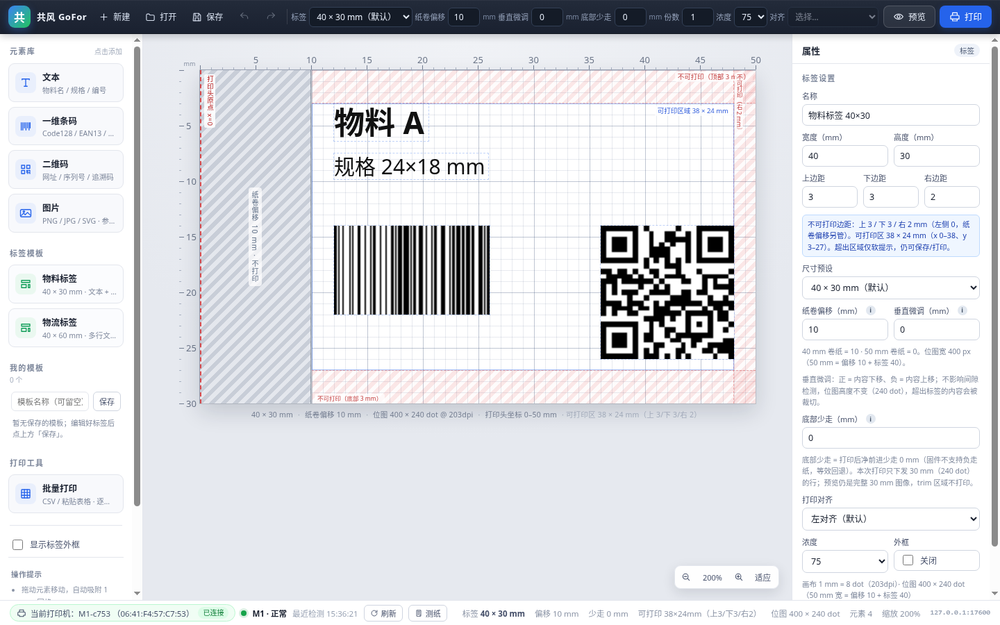

- 左：元素库（文本 / 条码 / 二维码 / **图片**）/ 标签模板 / 外框开关
- 中：打印头坐标 mm 标尺 + 1mm 网格；**左侧灰斜纹 = 纸卷偏移留白（10mm），红色虚线 = 打印头原点 x=0**；顶部/底部/右侧浅红斜纹标出可编辑的不可打印边距，中间细线框出可打印区域
- 右：所选元素 / 标签属性（含纸卷偏移说明）+ 实时 spec JSON
- 顶：品牌、新建、打开/保存 JSON、标签预设、**纸卷偏移 / 垂直微调 / 底部少走**、份数、浓度、对齐、预览、打印
- 条码/二维码：**服务端 zint 实时渲染**（与打印同一渲染器），画布即真实位图、按 px/8 换算 mm，所见即所得；拖右边缘/右下角改尺寸；离线自动回退示意占位
- 编辑：**撤销/重做（80 步）**、Shift 多选 / Ctrl+A 全选、以可打印区为基准的**对齐 / 等距分布**、图层上移/下移/置顶/置底、Ctrl+C/V 复制粘贴
- 批量：**批量打印**（CSV / 粘贴表格 + 文本 `{{列名}}` 占位逐行打印）、**我的模板**（localStorage 保存 / 一键新建）
- 打印机：状态栏入口 → **扫描蓝牙 / 选择 / 连接**，并支持**写入设备参数（207/208）**；记住上次选择与参数（localStorage），预览/打印请求自动带 `addr`
- 底：打印机状态（型号 / 状态 / 错误）、刷新、测纸、**偏移 / 可打印区 / 位图尺寸**

画布会按可编辑的「不可打印边距」标注区域：默认上 3 / 下 3 / 右 2mm（40×30 → 可打印区 **38×24mm**），顶部/底部/右侧浅红斜纹不可打印；元素越界时边框变黄并给出软提示（仍可保存/打印）：

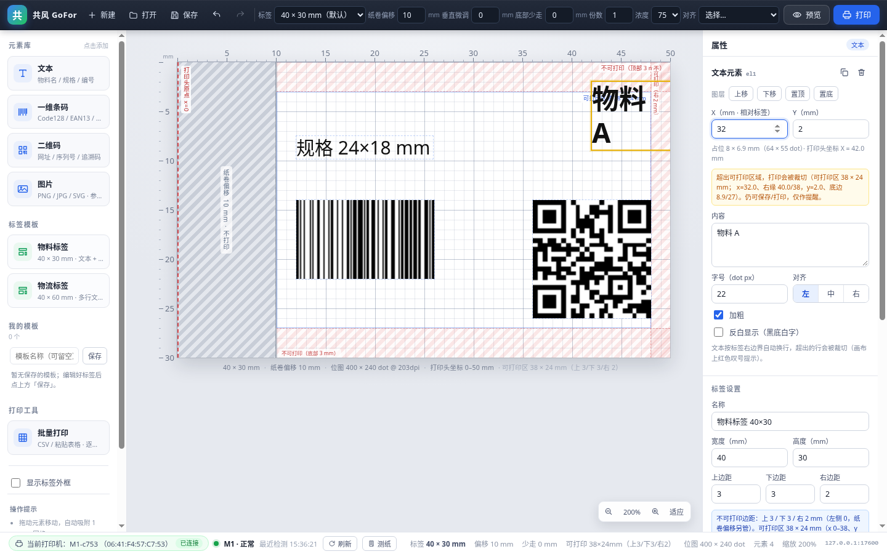

Shift / Ctrl 点击可多选，画布显示整体包围盒；右侧「多选」面板以可打印区为基准做对齐 / 等距分布 / 图层次序：

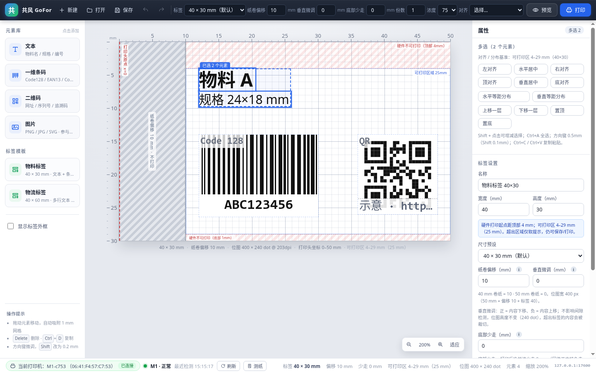

批量打印：导入 CSV 或粘贴表格，第一行表头，文本元素 `{{列名}}` 逐行替换，显示进度与失败行（每行一次 `/api/print`，`copies=1`，间隔 1s）：

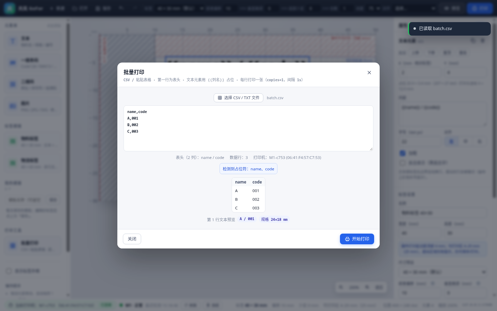

画布中的条码/二维码为服务端 zint 实时渲染（与打印同一渲染器），属性面板显示实际宽度，拖右边缘/右下角可改尺寸：

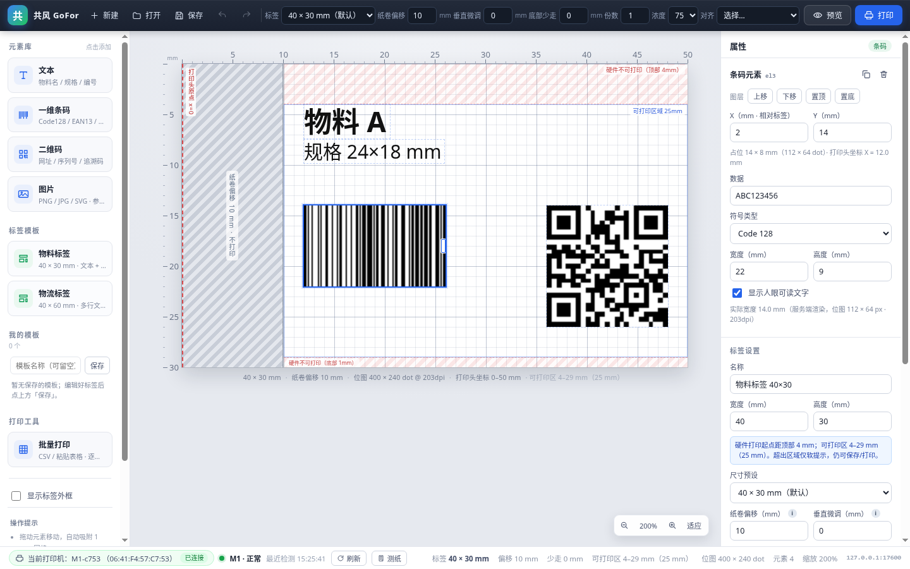

「我的模板」保存在 localStorage，可一键新建：

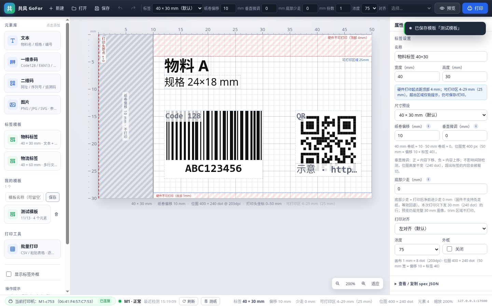

左侧元素库新增「图片」：选择 PNG / JPG / SVG 后作为**画布元素**参与排版（可拖拽、改宽高/对齐，最终随整个标签渲染）：

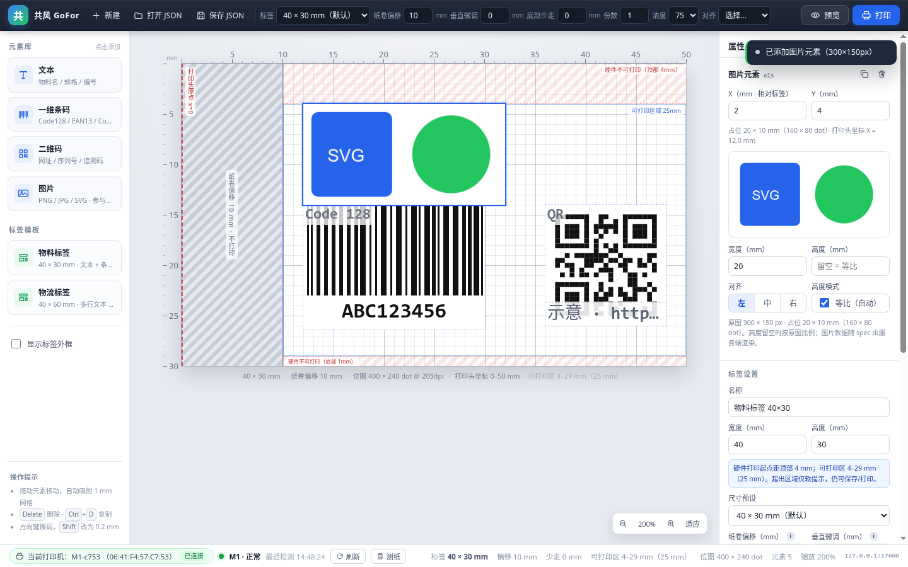

后端按「纸卷偏移 + 标签宽」渲染的真实 PNG 预览（40mm 纸 + 10mm 偏移 = 400 × 240 px）：


后端未启动时（不会白屏，给出错误与「重试」）：

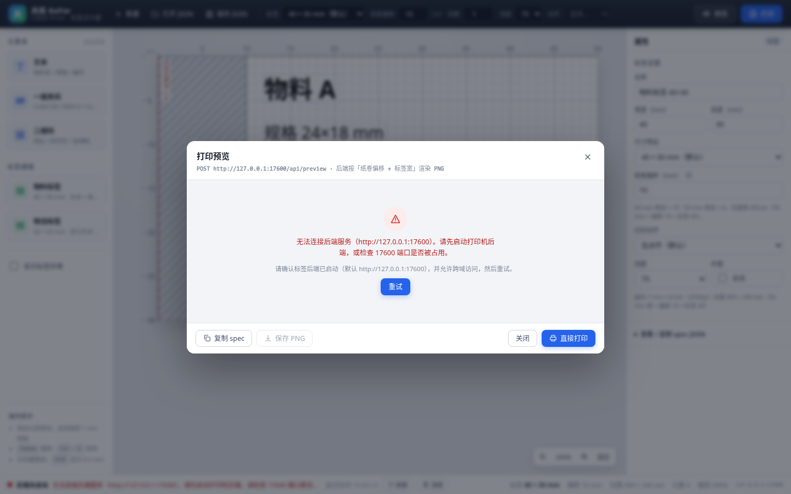

---

点击状态栏左侧的「当前打印机 / 选择打印机」芯片，可扫描蓝牙设备并连接，并写入打印机设置（207/208）；M1 高亮、选择与参数自动记住：

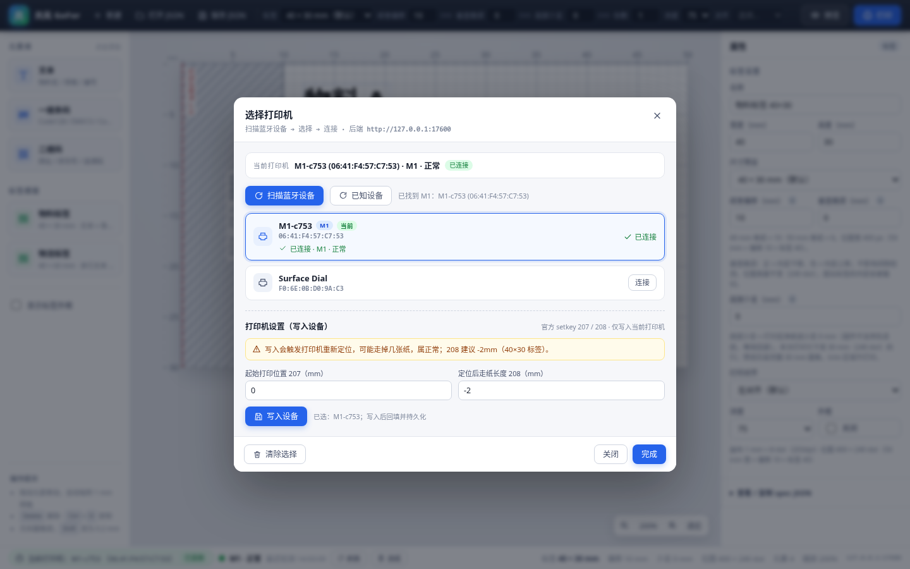

调整「垂直微调」时，标签区域顶部/底部会出现一条黄色虚线，提示可能被裁切的方向（不改变网格与元素坐标）：

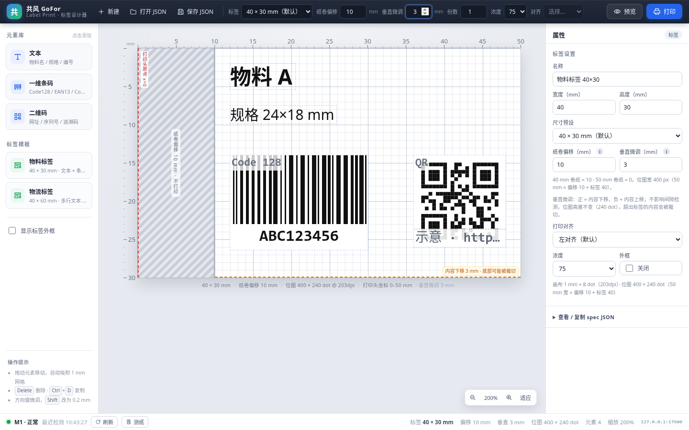

底部少走（`trim_bottom_mm`）只影响打印：画布底部用红色斜纹带标出「不打印」区域，预览仍是完整 30mm 图像：

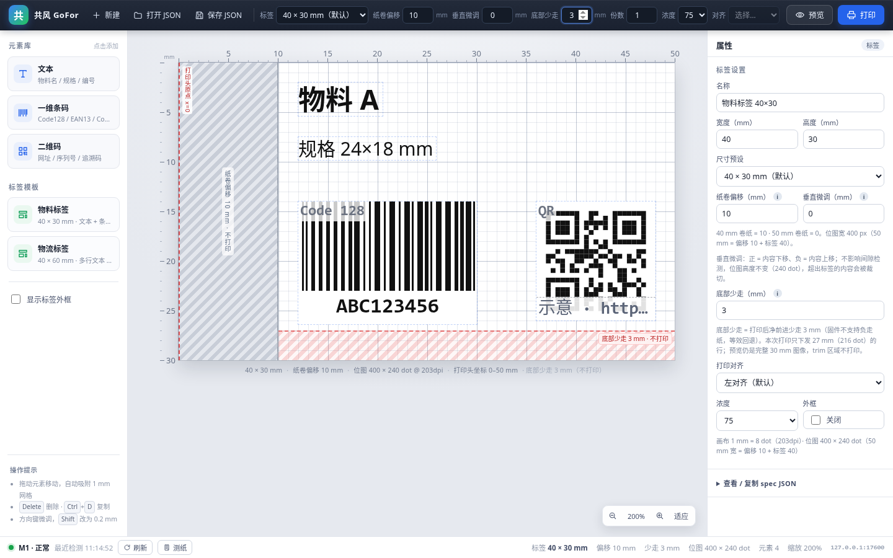

## 1. 快速开始

要求：Node.js ≥ 20.19（自测环境 Node v24.21.0 / npm 11.19.0）。

```bash
cd ui
npm install
npm run dev      # http://127.0.0.1:5173
```

生产构建与本地预览：

```bash
npm run build    # 产物在 ui/dist/
npm run preview  # http://127.0.0.1:4173
```

目录结构：

```
ui/
├── index.html            # 入口 HTML（中文 lang、原创 favicon）
├── package.json          # name: gofor-label-print，仅 vue + vite + @vitejs/plugin-vue
├── vite.config.js
├── docs/                 # 自测截图（editor / barcode-render / multi-select / batch-print / templates / …）
├── README.md
└── src/
    ├── main.js
    ├── App.vue           # 三栏布局 + 全局快捷键
    ├── api.js            # 后端 REST 封装（超时/错误友好化）
    ├── units.js          # mm↔dot、文字测量、按 mm 折行
    ├── label.js          # 文档模型、纸卷/垂直偏移、可打印区、元素尺寸、spec 序列化
    ├── imageElement.js   # 图片元素：SVG 栅格化、大图压缩、dataURL 生成
    ├── elementRender.js  # 条码/二维码服务端实时渲染缓存（防抖/降级/位图尺寸）
    ├── styles.css        # 全部样式（深色工具条 + 浅色工作区）
    ├── components/
    │   ├── AppToolbar.vue      # 顶部工具条（含纸卷 / 垂直偏移输入）
    │   ├── ElementPalette.vue  # 左侧元素库/模板
    │   ├── LabelCanvas.vue     # 画布、打印头原点/偏移留白、mm 标尺、拖拽/缩放
    │   ├── LabelElement.vue    # 文本、条码/二维码（服务端 PNG）、图片元素
    │   ├── PropertyPanel.vue   # 右侧属性面板 + spec JSON
    │   ├── StatusBar.vue       # 打印机状态栏
    │   ├── PrinterDialog.vue   # 打印机扫描 / 选择 / 连接 / 设置弹窗
    │   ├── PreviewDialog.vue   # 预览弹窗
    │   ├── ToastStack.vue
    │   └── AppIcon.vue         # 原创 24×24 线稿图标
    └── stores/store.js   # reactive 全局状态 + 所有动作（无 pinia）
```

---

## 2. 纸卷偏移 / 垂直微调 / 底部少走（关键硬件事实）

M1 的**纸筒挡板在左侧、纸筒仓宽 50mm**：装入 40mm 卷纸后，纸面相对打印头原点整体**右移 10mm**。
若不把偏移告诉后端，位图会从打印头 x=0 开始画，导致**左侧被裁、文字显示不全**。

| 规则 | 说明 |
| --- | --- |
| 字段 | 标签级 `offset_x_mm`（与 `width_mm` / `height_mm` / `border` / `density` 同级） |
| 默认值 | **10.0**（40mm 卷纸）；范围 **0 ~ 20**，步进 **0.5** |
| 常用取值 | **40mm 纸 = 10；50mm 纸 = 0**（挡板在左，纸卷靠左装入后右移） |
| 垂直微调 | 标签级 `offset_y_mm`：默认 **0**，范围 **-15 ~ 15**，步进 0.5；**正 = 内容下移、负 = 内容上移** |
| 底部少走 | 标签级 `trim_bottom_mm`：默认 **0**，范围 **0 ~ 5**，步进 0.5；固件不支持反向走纸，用「少走」等效回退，打印只下发 `(高度 − trim)` 行 |
| 输入位置 | 顶部工具条「纸卷偏移 / 垂直微调 / 底部少走」+ 右侧「标签设置」对应输入（均带说明气泡） |
| 预设联动 | 切 40×30 / 40×60 → 自动 10；切 50×30 → 自动 0（仍可手动微调） |
| 画布可视化 | 红色虚线 = 打印头原点 **x=0**；左侧浅灰斜纹 = **偏移留白（不打印）**；标签内容、网格、**外框都只从纸边（x=offset）开始** |
| 标尺 | 按**打印头坐标**标注 `0 … offset+width`（40mm 纸 + 10mm 偏移 → 0~50mm） |
| 后端渲染 | 位图宽 = `offset + width`（40 + 10 → **400px**），内容整体右移 offset 绘制；`/api/preview` 返回的 PNG 即真实横向位置 |
| 默认值 | `offset_y_mm = 0`、`trim_bottom_mm = 0`（打印流已自动走到下一张缝隙） |
| 垂直画布提示 | `offset_y_mm ≠ 0` 时，在标签区域**下移→底部 / 上移→顶部**画一条黄色虚线，仅提示可能被裁切的方向，不改网格/坐标 |
| 垂直渲染 | 内容整体上下平移 `offset_y_mm`，**位图高度不变**（40×30mm 仍为 240px），越界部分被裁切 |
| 底部少走提示 | 画布底部 `trim_bottom_mm` 高度区域用红色斜纹带标出「不打印」；内容伸入该区域时属性面板告警，可用垂直微调上移内容 |
| 底部少走渲染 | 预览仍是完整标签图像（40×30mm）；**打印时只下发 `(height − trim)` 行**，等效「打印后回退」（固件不支持负走纸） |
| 上限校验 | `offset + width > 50mm`（400px）时属性面板给出黄色告警，后端也会返回 400 |

> 编辑器内部元素的 `x_mm` 始终**相对标签纸左边**（0…width），打印头物理位置 = `offset_x_mm + x_mm`；
> 属性面板会同时显示「打印头坐标 X」。
>
> **垂直微调 `offset_y_mm`**：用于补偿标签在打印头上的上下位置偏差——内容整体上下微调，不影响间隙检测；正 = 下移、负 = 上移；位图高度不变，超出标签的部分会被裁切。
>
> **底部少走 `trim_bottom_mm`**：固件不支持反向走纸，「打印后回退」用「打印后少走」等效实现——打印时只下发 `(标签高度 − trim)` 行，预览不受影响（仍是完整图像）；默认 **0**（打印流已自动走到下一张缝隙），如撕纸位置有偏差可手动设 1~2mm。trim 区域不打印，可用垂直微调把内容上移。

### 可打印区域（可编辑边距，软提示，不限制拖拽）

不可打印边距可自由设置：**上 `margin_top_mm` / 下 `margin_bottom_mm` / 右 `margin_right_mm`**，默认 **3 / 3 / 2mm**，范围 **0~10**、步进 **0.5**；左侧固定 0（纸卷偏移另管）。设置入口在右侧「标签设置」，并持久化到 localStorage（键 `gofor-label-margins-v1`），刷新/新建/打开后回填。

可打印区域 = **x ∈ [0, width − margin_right]**、**y ∈ [margin_top, height − margin_bottom]**；40×30 默认为 **38 × 24 mm**。

| 位置 | 表现 |
| --- | --- |
| 画布 | 上/下/右三侧浅红斜纹带宽度 = 对应边距；中间细实线框出可打印区域并标「可打印区域 38 × 24 mm」，两侧说明显示实际上/下/右边距 |
| 越界元素 | 超出上/下/右任一边界时元素边框变黄，属性面板黄色提示具体可打印区与实际坐标（x/右缘、y/底边），但**仍可保存/打印**（仅软提醒，不做任何 clamp） |
| 对齐/分布 | 以该可打印区域为基准：左=0、右=width−margin_right、上=margin_top、下=height−margin_bottom |
| 状态栏 | 显示摘要「可打印 38×24mm（上3/下3/右2）」 |
| 持久化 | localStorage `gofor-label-margins-v1`（只影响编辑器标注/对齐，不改变后端打印流程） |
>
---

## 3. 打印机扫描 / 选择 / 连接

首次使用或换机时，点击状态栏左侧的「当前打印机 / 选择打印机」芯片打开弹窗：

1. 打开时自动读取 **已知设备**（`GET /api/devices`，快）；点「扫描蓝牙设备」调用 `GET /api/scan?seconds=8` 主动扫描（按钮显示「扫描中…（约 8 秒）」并禁用）。
2. 设备列表显示「名称 + 地址」，**M1 设备高亮并带「M1」徽标**；每行「连接」调用 `POST /api/connect`（body `{"addr":"..."}`）。
3. 连接成功：行内显示 ✅「已连接 · M1 · 正常」；失败：行内展示后端返回的原始 error 文案（打印机可能被占用，busy 属正常现象），不会白屏。
4. **记住最近选择**：地址/名称/型号写入 `localStorage`（key `gofor-label-printer-v1`），下次打开自动显示在状态栏并查询该机状态。
5. **预览与打印必须先选打印机**：未选时点击会 toast「请先选择打印机」并自动打开本弹窗；请求体统一带上 `addr`（`{"addr": "...", ...spec}`）。`/api/preview` 会忽略 addr，`/api/print` 用 addr 指定目标机；状态查询与测纸也会带当前地址。
6. 后端离线：状态栏显示「后端未启动 / 离线」，弹窗顶部红色横幅「后端未启动或无法连接…」并提供「重试」，页面正常渲染。
7. **打印机设置（写入设备）**：弹窗底部可写官方 setkey 参数——207「起始打印位置」（-5~5mm，步进 0.5，默认 0）与 208「定位后走纸长度」（-5~5mm，步进 0.5，默认 **-2**，40×30 实测 -2mm 对齐撕纸梳）。写入调用 `POST /api/printer/params`（body `{"addr":"...", "start_pos_mm":0, "feed_after_pos_mm":-2}`，两字段均可选）。**写入会触发打印机重新定位、可能走掉几张纸（属正常）**；成功显示后端 `written` 内容并 toast「已写入打印机」，失败显示后端 error 原文。参数保存在 `localStorage`（key `gofor-label-printer-settings-v1`），下次打开回填；**不参与每次打印/预览请求**。

---

## 4. 图片元素（参与排版）

左侧元素库点击「图片」→ 选择 `.png` / `.jpg` / `.jpeg` / `.svg`，图片会作为 **`type:"image"` 画布元素**加入标签（不是单独弹窗打印）：

1. **SVG 在浏览器端栅格化**：Image 加载 → canvas 白底绘制 → PNG dataURL；PNG / JPG 也统一解码后重绘为白底 PNG/JPEG dataURL（透明区域变白，避免热敏打印成黑块）。
2. 新图片默认放在可打印区内（x=2、y=当前上边距），宽度 **20mm**、高度留空（按原图比例）。
3. 画布用 `` 渲染，可拖拽、选中；右侧属性面板可改 **X / Y / 宽度(mm) / 高度(mm) / 对齐**，高度留空或勾选「等比（自动）」时按原图比例。
4. **大图体积控制**：源 dataURL > 2MB 或像素过大时，先在 canvas 缩到最长边 **800px** 再转 dataURL（PNG 仍超 2MB 时降级 JPEG），保证 spec 不至于过大（后端上限 16MB）。
5. 预览/打印时图片元素原样进入 spec（`src` = dataURL），由服务端按 `width_mm`/`height_mm` 以 203dpi LANCZOS 缩放后贴到画布；属性面板的 spec JSON 展示会**截断 src**，复制/导出仍包含完整 dataURL。

> 图片元素只是普通元素：拖出可打印区域时同样只有黄色软提醒，不影响保存/打印。

---

## 5. 单位与坐标（为什么不会再「文字显示不全 / 宽高反了」）

| 概念 | 规则 |
| --- | --- |
| 分辨率 | 203dpi ≈ **8 dot/mm**（画布内部布局单位 = dot） |
| 标签尺寸 | `width_mm × height_mm`，40×30mm = **320×240 dot** |
| 位图尺寸 | `(offset_x_mm + width_mm) × height_mm`，40mm 纸 + 10mm 偏移 = **400×240 dot** |
| 元素坐标 | `x_mm` / `y_mm`（相对标签纸），面板显示 mm，渲染时 `dot × zoom`；可自由摆放（y ≥ 0） |
| 标尺/网格 | 上方/左侧 mm 刻度（打印头坐标），1mm 网格；拖拽吸附 1mm，`Shift` 精细到 0.1mm |
| 元素边框 | 所有元素常显淡虚线边框，选中为 2px 实线，超出标签范围出现红色叹号 |
| 文字 | `size` 是 **dot 字号**（28 ≈ 3.5mm 高）；按「标签右边界 − x」的可用宽度**逐行折行**（中文按字、西文按词、超长串按字符硬切），逐行绝对定位渲染，行高 1.25×字号，超出标签高度的行被裁切并告警 |
| 条码 | 画布显示 `/api/element/render` 返回的真实 zint PNG；元素尺寸 = 位图 px / 8（如 224px → 28mm）；请求宽度 `width_mm`，实际宽度受模块整数取整，属性面板显示「实际宽度」（与打印同一渲染器） |
| 二维码 | 同样显示服务端 PNG；元素尺寸 = 位图 px / 8（如 96px → 12mm），`size_mm` 为请求值，模块取整后可能略有差异 |

---

## 6. 与后端联调

后端（M1 REST 打印服务，位于仓库 `server/`）默认监听 **http://127.0.0.1:17600**。
前端 API 基址可用环境变量覆盖（构建时注入）：

```bash
# 例如后端跑在另一台机器
VITE_LABEL_API_BASE=http://192.168.1.20:17600 npm run build
```

| 方法 | 路径 | 用途 | 前端处理 |
| --- | --- | --- | --- |
| `GET` | `/api/status?addr=` | 指定打印机型号/状态/错误 | 进入页面即请求（带当前 addr），之后每 15s 轮询；状态栏 `未选 / 已连接 / 离线` |
| `GET` | `/api/devices` | 已知蓝牙设备（快，不扫描） | 打开打印机弹窗时自动读取，显示名称/地址 |
| `GET` | `/api/scan?seconds=8` | 主动扫描蓝牙设备 | 「扫描蓝牙设备」按钮；扫描中禁用并显示 loading |
| `POST` | `/api/connect` | 连接指定地址并握手（body `{"addr":...}`） | 设备行「连接」；成功显示型号/状态，失败展示后端 error 原文 |
| `POST` | `/api/printer/params` | 写入设备参数 207/208（body `{addr, start_pos_mm?, feed_after_pos_mm?}`） | 弹窗「打印机设置」；显示 `written`/error，参数写入 localStorage |
| `POST` | `/api/element/render` | 渲染单个条码/二维码（body `{type, symbology, data, width_mm, height_mm, show_text, size_mm}`），返回 PNG | 画布元素实时图；防抖 300ms、blob URL 缓存、失败回退示意占位 |
| `POST` | `/api/preview` | 传 spec（含 `addr`），返回 PNG | 兼容 `image/png` 与 JSON base64；弹窗显示，可保存 PNG |
| `POST` | `/api/print` | 传 spec + `addr` + `copies`，真正打印 | 成功 toast，失败 toast + 状态栏离线提示 |
| `POST` | `/api/learn` | 测纸 / 重新定位（会走纸！） | 状态栏「测纸」按钮（带当前 addr），成功/失败 toast |

- 后端已返回 `Access-Control-Allow-Origin: *`，本地 `5173 → 17600` 跨域可直接工作（自测验证）。
- 预览/打印请求体以 `addr` 开头：`{"addr":"<当前打印机蓝牙地址>", ...spec}`；未选择打印机时前端会拦截并提示「请先选择打印机」。
- 请求超时：状态 4.5s、预览 20s、打印 25s、测纸 20s。
- **后端未启动时的降级行为**（已验证）：
  - 状态栏红点 + 「后端未启动」+ 具体网络错误，不白屏；
  - 预览弹窗显示错误原因与「重试」，并保留「复制 spec」；
  - 打印/测纸 toast 报错，编辑器本身可继续离线设计、导出 JSON。

预览/打印请求体都带 `offset_x_mm`；打印额外带份数：

```json
{ "width_mm": 40, "height_mm": 30, "border": false,
  "offset_x_mm": 10, "offset_y_mm": 0, "trim_bottom_mm": 0, "density": 75,
  "copies": 2, "items": [ ... ] }
```

---

## 7. 标签 spec 契约（前后端严格一致）

编辑器导出的 JSON 只包含契约字段（`id`、名称、缩放等编辑器内部状态不会导出）：

```json
{
  "width_mm": 40,
  "height_mm": 30,
  "border": false,
  "offset_x_mm": 10,
  "offset_y_mm": 0,
  "trim_bottom_mm": 0,
  "density": 75,
  "items": [
    { "type": "text", "text": "物料 A", "size": 28, "bold": true, "align": "left", "x_mm": 2, "y_mm": 2 },
    { "type": "barcode", "data": "ABC123", "symbology": "code128", "width_mm": 22, "height_mm": 12, "x_mm": 2, "y_mm": 15 },
    { "type": "qr", "data": "https://x", "size_mm": 14, "x_mm": 18, "y_mm": 14 },
    { "type": "image", "src": "data:image/png;base64,…", "width_mm": 20, "x_mm": 2, "y_mm": 4 }
  ]
}
```

| 字段 | 类型 | 说明 |
| --- | --- | --- |
| `width_mm` / `height_mm` | number | 标签宽高（mm），默认 40 × 30 |
| `border` | boolean | 是否打印标签外框（只画在标签区域内，不含偏移留白） |
| `offset_x_mm` | number | 纸卷偏移（mm），默认 10，范围 0~20，步进 0.5 |
| `offset_y_mm` | number | 垂直微调（mm），默认 0，范围 -15~15，步进 0.5；正=下移、负=上移 |
| `trim_bottom_mm` | number | 底部少走（mm），默认 0，范围 0~5，步进 0.5；打印只下发 `(高度 − trim)` 行，等效回退 |
| `density` | number | 打印浓度，限 35 / 55 / 75 / 95 |
| `items[].type` | string | `text` / `barcode` / `qr` / `image` |
| `items[].x_mm` / `y_mm` | number | 相对标签纸左上角坐标（mm）；编辑器总是输出 |
| text：`text` / `size` / `bold` / `align` | | 内容 / dot 字号 / 加粗 / `left`·`center`·`right` |
| barcode：`data` / `symbology` / `width_mm` / `height_mm` | | 数据 / `code128`·`ean13`·`code39` / 请求宽度（mm，5–72） / 条码高度（mm） |
| qr：`data` / `size_mm` | | 数据 / 边长（mm） |
| image：`src` / `width_mm` / `height_mm` / `align` | | dataURL（必填）/ 宽（默认 20）/ 高（可选，缺省按原图比例）/ 对齐 |

**可选扩展字段**（后端支持，默认不输出，保持与基础契约兼容）：

| 字段 | 输出时机 | 说明 |
| --- | --- | --- |
| `show_text` | 条码开启「显示人眼可读文字」时为 `true` | 否则省略（后端默认 true） |
| `invert` | 文本开启「反白显示」时为 `true` | 黑底白字 |
| 顶层 `align` | 打印对齐不是 `left` 时输出 | `left` / `center` / `right` |
| 顶层 `copies` | 仅 `/api/print` 请求体 | 打印份数 1–99 |

其他说明：

- 纸卷偏移、文本折行宽度、条码高度、二维码边长全部按 mm 计算；
- 画布条码/二维码来自 `/api/element/render`（与 `/api/preview`、`/api/print` 同一 zint 渲染器）；打印 spec 只带 `width_mm` / `size_mm` 等参数，后端按同参数重渲染，因此画布 = 预览 = 打印；
- 条码实际宽度受模块整数取整（例如请求 22mm 可能渲染为 14mm），属性面板显示「实际宽度 X mm（服务端渲染）」，拖拽右边缘可直接调整；
- 图片元素 `src` 为 dataURL（大图已在浏览器端压缩到最长边 800px / ≤2MB），服务端按 mm 尺寸 LANCZOS 缩放渲染；
- 打开 JSON 时字段缺失会用默认值补齐（旧文件无 `offset_x_mm` 按 10、无 `offset_y_mm` 按 0、无 `trim_bottom_mm` 按 0 处理），非法 JSON / 缺少宽高会 toast 报错，不打断当前编辑。

---

## 8. 操作说明

| 操作 | 方式 |
| --- | --- |
| 添加元素 | 左侧元素库点击「文本 / 一维条码 / 二维码」 |
| 选中 / 取消 | 点击元素 / 点击画布空白处（含偏移留白）或 `Esc` |
| 移动 | 鼠标拖动（1mm 吸附；`Shift` 为 0.1mm；方向键 0.5mm，`Shift`+方向键 0.1mm；多选时整体移动） |
| 撤销 / 重做 | `Ctrl+Z` / `Ctrl+Shift+Z`（Cmd 同理）或工具栏按钮；历史栈 80 步，覆盖添加/删除/拖动/属性/对齐/图片/尺寸 |
| 多选 | `Shift`+点击（或 `Ctrl`/`Cmd`+点击）增减选中；`Ctrl+A` 全选；画布显示整体包围盒 |
| 删除 / 复制 | `Delete` 删除选中；`Ctrl+D` 复制选中元素 |
| 多选对齐 | 右侧「多选」面板 左/水平居中/右/顶/垂直居中/底对齐，基准为可配置可打印区；工具栏「对齐」下拉同样可用 |
| 等距分布 | 右侧「多选」面板 水平/垂直等距分布（≥2 个元素，基准可打印区） |
| 图层顺序 | 属性面板「上移 / 下移 / 置顶 / 置底」 |
| 复制粘贴 | `Ctrl+C` / `Ctrl+V`（应用内剪贴板，粘贴偏移 2mm，可连续粘贴） |
| 批量打印 | 左侧「打印工具 → 批量打印」→ 导入 CSV / 粘贴表格 → 开始打印（每行 1 份，间隔 1s，可停止） |
| 我的模板 | 左侧「我的模板」→ 输入名称保存 → 点击模板一键新建 / 垃圾桶删除 |
| 修改参数 | 右侧属性面板（内容、字号、加粗、对齐、反白、条码符号/宽度/高度/文字、二维码尺寸） |
| 条码/二维码尺寸 | 选中后拖条码右边缘改宽度、拖二维码右下角改尺寸，或直接改属性面板宽度/尺寸；300ms 防抖后重新请求服务端渲染 |
| 打印机 | 点击状态栏「当前打印机 / 选择打印机」芯片 → 扫描 → 连接；选择会记在 localStorage |
| 可打印区域 | 属性面板「标签设置」可改上/下/右不可打印边距（0~10mm，步进 0.5）；画布斜纹带与细线框、状态栏摘要实时更新；越界仅黄色软提醒 |
| 图片元素 | 左侧元素库「图片」→ 选择 PNG / JPG / SVG → 作为画布元素加入，可拖拽/改宽高/对齐 |
| 纸卷偏移 | 顶部工具条或右侧「标签设置 → 纸卷偏移 mm」，40mm 纸填 10、50mm 纸填 0 |
| 垂直微调 | 顶部工具条或右侧「垂直微调 mm」：正 = 内容下移、负 = 上移（-15~15，步进 0.5） |
| 底部少走 | 顶部工具条或右侧「底部少走 mm」：打印后少走多少 mm，等效回退（0~5，默认 0，可手动调 1~2） |
| 元素对齐标签 | 顶部「对齐」下拉（左/水平居中/右/上/垂直居中/下） |
| 标签尺寸 | 顶部「标签」预设（40×30 / 40×60 / 50×30 / 自定义 mm），会自动匹配纸卷偏移 |
| 缩放画布 | 右下角 `-` / `%` / `+` / 「适应」 |
| 保存 / 打开 | 顶部按钮（保存为浏览器下载 `.json`；打开本地 `.json`） |
| 打印对齐 | 右侧「标签设置 → 打印对齐」（直接作用于后端 `align`） |

---

## 9. 批量打印 / 我的模板

### 9.1 批量打印（CSV / 粘贴表格）

入口：左侧「打印工具 → 批量打印」（需先选择打印机；未选择会提示并打开打印机弹窗）。

1. 第一行为表头；支持逗号或制表符（Excel/TSV 直接粘贴）、双引号包裹、引号内换行；可导入 CSV/TXT 文件或直接粘贴。
2. 文本元素用 `{{列名}}` 占位（如 `{{name}} / {{code}}`）；弹窗显示表头、数据行数、检测到的占位符、缺少列提示与第 1 行文本预览。
3. 逐行生成 spec（只替换 text 元素），每行调用一次 `POST /api/print`，`copies: 1`，行间间隔 **1s**；不改变后端打印流程。
4. 显示进度（第 X/N 行、成功/失败数）与失败行号 + 后端 error 原文；可「停止」（当前行完成后停止）。
5. 批量打印忽略顶部「份数」设置（固定每行 1 份）；表格缺少某列时保留原占位文字。

### 9.2 我的模板（localStorage）

入口：左侧「我的模板」。

- 输入名称（可留空，默认用当前标签名）→「保存」：把当前标签的完整 spec 快照写入 localStorage（键 `gofor-label-templates-v1`，最多 30 个）。
- 模板列表显示名称 / 日期 / 元素数；点击卡片一键新建（载入 spec，含图片元素 dataURL），点垃圾桶删除。
- 存储空间不足（图片较多的模板）会 toast 保存失败，不影响已有模板；新建/载入模板会重置撤销栈。

---

## 10. 自测结果（2026-11-13，本机）

### 10.1 命令

```text
$ cd ui && npm install
added 34 packages in 17s

$ npm run build
vite v7.3.8 building client environment for production...
✓ 23 modules transformed.
dist/index.html                   1.07 kB │ gzip:  0.65 kB
dist/assets/index-Y8A9X1Zc.css   31.26 kB │ gzip:  7.01 kB
dist/assets/index-DimUIIwK.js   191.48 kB │ gzip: 67.55 kB
✓ built in 772ms

$ npm run dev        # VITE v7.3.8 ready → http://127.0.0.1:5173/
$ curl -o /dev/null -w '%{http_code}' http://127.0.0.1:5173/           # 200
$ curl -o /dev/null -w '%{http_code}' http://127.0.0.1:5173/src/main.js # 200
```

### 10.2 浏览器实测（Playwright Chromium，1440 × 900）

| 撤销/重做 | 添加元素 → 撤销数量 -1 → 重做恢复；拖动/属性改字号/标签宽 50mm/图片添加/对齐 均可用 Ctrl+Z 还原；连续添加 55 个后可撤销 55 步（历史栈 80） |
| 多选 | Shift+点击两个元素 → 面板「多选 2」、整体包围盒出现；组拖拽 +3/+1mm 同步移动，撤销恢复；Ctrl+A 全选、Delete 删除全部、撤销恢复 |
| 对齐/分布（可打印区基准） | 默认边距 3/3/2 时：左对齐 x=0；顶对齐 y=3；底对齐底边=27；右对齐右缘=38；水平分布右缘=38；垂直分布 3→27；改边距后基准同步变化 |
| 图层 | 置顶后选中元素位于 DOM 最后（4/4），置底后位于 0，撤销恢复原顺序 |
| 复制粘贴/微移 | Ctrl+C/V 复制元素偏移 +2mm；方向键 0.5mm、Shift 0.1mm；Ctrl+D 多选复制 2 个 |
| 批量打印成功 | 文本改为 `{{name}} / {{code}}`，导入 3 行 CSV：mock 捕获 3 次 /api/print，文本依次 A/001、B/002、C/003，`copies=1` 且带 addr；进度 3/3、成功 3、无失败行 |
| 批量打印失败 | mock 第 2 行返回 ok:false → 进度 3/3、成功 2、失败 1，失败行显示「第 2 行：mock 设备忙」并提示总数 |
| 我的模板 | 保存「测试模板」→ localStorage 1 条（名称/日期/4 元素）；刷新后仍在；点击后标签名变「测试模板」并 toast；删除后列表与 localStorage 清空 |

> 打印机设置（207/208）、打印请求与图片元素的 spec 组装均使用 mock 验证，**未触发真机写入/出纸**；连接、状态查询与预览为真机验证。

| 项目 | 结果 |
| --- | --- |
| 页面标题 | 「共风 GoFor Label Print · 标签设计器」 |
| 默认画布（offset 10） | 位图区 800 × 480 CSS px @ zoom 200%，比例 1.667 = 50/30；灰斜纹留白 160px（= 10/50 = 20%）；标签区域 left=160、宽 640px |
| 偏移 = 0 | 留白消失、比例 1.333 = 40/30、位图 320 × 240 dot、标尺 0–40mm |
| 切回偏移 = 10 | 留白恢复 160px、位图 400 × 240 dot、标尺 0–50mm |
| 元素位置 | 文本 x=2mm → 相对位图左缘 193px（= 偏移 160px + 2mm×8×2.0），内容确实从偏移线开始 |
| 外框约束 | 打开外框后边框只覆盖标签区域（left 161 ≈ 偏移 160 + 1px 内衬，width 639 ≈ 640），**不会画到偏移留白上** |
| 预设联动 | 50×30 → 自动 offset 0（toast 提示）；40×30 → 自动 offset 10 |
| 保存 JSON | 顶层含 `"offset_x_mm": 10`，字段与契约一致（无 id/名称） |
| 后端状态 | `GET /api/status` → 200，状态栏「M1 · 正常」绿点 +「偏移 10 mm / 位图 400 × 240 dot」 |
| 垂直微调 | 工具条 / 属性面板设 **+3** → 画布底部黄色虚线「内容下移 3 mm · 底部可能被裁切」，spec 顶层 `offset_y_mm: 3`；设 **-2** → 顶部提示；网格与元素坐标不变 |
| 旧 JSON 兼容 | 打开无 `offset_y_mm` 的旧文件 → 自动按 0 处理，spec 顶层补出 `offset_y_mm: 0` |
| 打印机入口 | 未选时状态栏「选择打印机 / 未选」；点击打开弹窗并自动读取已知设备（M1-c753 + Surface Dial），M1 行高亮 + 「M1」徽标 |
| 扫描 | 点击「扫描蓝牙设备」→「扫描中…（约 8 秒）」+ 禁用/转圈；完成后列表刷新；后端离线时横幅提示 + 重试 |
| 连接 | M1「连接」→「连接中…」→ ✅ 已连接 · M1 · 正常；状态栏「当前打印机：M1-c753（06:41:F4:57:C7:53）已连接」；localStorage 写入，刷新页面后仍显示并自动查询状态 |
| 连接失败 | mock 后端 busy：`{"ok":false,"error":"设备忙：…"}` → 行内显示后端原始文案 + 失败 toast；连接另一台失败不影响当前已连接打印机 |
| 选机约束 | 未选打印机点预览 → toast「请先选择打印机」并打开打印机弹窗（预览不打开）；选机后 preview/print 请求体均以 `addr` 开头（实测捕获） |
| 离线降级 | 后端离线 → 状态栏「后端未启动」+ 连接状态「离线」；弹窗红色横幅「后端未启动或无法连接…」+「重试」；页面正常渲染 |
| 可打印边距默认值 | 默认上3/下3/右2；画布上/下斜纹带各 48px、右侧 32px（zoom2），可打印框 608×384px（38×24mm）；标注「可打印区域 38 × 24 mm」，状态栏「可打印 38×24mm（上3/下3/右2）」 |
| 边距编辑与持久化 | 改为 5/4/6 → 斜纹带 80/64/96px、可打印区 34×21mm、状态栏实时更新；localStorage 写入 `{top_mm:5,bottom_mm:4,right_mm:6}`，刷新后回填 |
| 越界软提醒 | x=35、y=2（上/右越界）→ 黄色边框，面板提示「可打印区 38×24 mm；x=35、右缘 40/38，y=2、底边 12.3/27」；预览/打印仍可用、spec 保存原值（无 clamp） |
| 条码/二维码实时渲染 | 画布条码/二维码为 blob URL 的真实 PNG：条码 112×64 px → 元素 14×8mm，二维码 96×96 px → 12×12mm；占位 SVG 数量为 0 |
| 防抖与缓存 | 连续输入 8 个字符（60ms 间隔）只发 1 次 /api/element/render；缓存 key 含 type/symbology/data/width/height/show_text |
| 拖拽改尺寸 | 拖条码右边缘 width_mm 22→24 并重新请求；拖二维码右下角 size 12→14（返回 100×100 px，画布按 12.5mm 显示） |
| 实际宽度提示 | 属性面板显示「实际宽度 14.0 mm（服务端渲染，位图 112×64 px · 203dpi）」，旧「示意宽约…以预览为准」已移除 |
| 离线回退 | 拦截 /api/element/render 后刷新：画布回退示意占位、页面不白屏、属性面板提示失败；恢复后端并改参数后重新显示真实图 |
| 打印一致性 | mock 捕获打印 spec：barcode `width_mm:24, height_mm:9`、qr `size_mm:14`；后端 element/render 与 preview 的黑色像素尺寸一致（条码 224×70、二维码 96×96 / 100×100） |
| 图片元素（SVG） | 元素库「图片」选择 SVG → 画布出现 image 元素：原图 300×150、宽 20mm、等比高 10mm、y=4；选中后属性面板含 X/Y/宽度/高度/对齐/等比 |
| 图片元素编辑 | 宽改 30 → 等比高自动 15mm；高度固定 8 → spec `height_mm:8`；勾回等比 → spec 省略 height；对齐居中 → spec `align:"center"`；拖动 +2/+1mm 生效 |
| 大图体积控制 | 2.8MB PNG（2000×1500）→ 画布元素原图 800×600、dataURL 约 0.4MB（PNG 超限降级 JPEG）；spec 面板 src 截断提示，复制/导出仍为完整 dataURL |
| 图片进 spec | mock 捕获 preview/print 请求体：items 含 `{type:"image", src:"data:image/...", width_mm:20, y_mm:4}`（高度留空时省略），随普通标签一起渲染；**未真机打印** |
| 打印机设置 | 弹窗「打印机设置（写入设备）」：黄色提示「写入会触发打印机重新定位…208 建议 -2mm」；默认 207=0、208=-2，范围 -5~5 步进 0.5 |
| 写入成功（mock） | 输入 1.5/-1.5 → 「写入中…」按钮/输入禁用 → 显示「已写入：207=1.5mm(18)，208=-1.5mm(-18)」+ toast「已写入打印机」；请求体含 addr/start_pos_mm/feed_after_pos_mm；localStorage 持久化，刷新后回填 |
| 写入失败（mock） | 后端返回 `{ok:false,error:"设备忙：…"}` → 设置区显示后端原文 + 失败 toast；不覆盖已保存值 |
| 默认值 | spec 顶层 `offset_y_mm: 0`、`trim_bottom_mm: 0`（无底部 trim 提示带） |
| 底部少走 | 默认 0 → 无底部提示带；设 3 → 红色斜纹带高 48px（10%）；设 0 → 带消失；内容伸入修剪区（trim=5，内容底 26.4mm > 边界 25mm）→ 属性面板黄色告警 |
| 底部少走兼容 | 打开无 `trim_bottom_mm` 的旧 JSON → 自动按 0，输入框与 spec 均为 0 |
| 后端预览 | `POST /api/preview` 请求体以 `addr` 开头，含 `offset_x_mm: 10`、`offset_y_mm: 0`、`trim_bottom_mm: 0` → 返回 **400 × 240** 完整 PNG，弹窗正常显示 |
| 打印请求 | 用 mock 的 `/api/print` 捕获请求体：含 `addr`、`offset_x_mm: 10`、`offset_y_mm: 0`、`trim_bottom_mm: 0` 与 `copies`，toast「打印任务已发送」；**未触发真机出纸** |
| 几何上限 | 50mm 标签 + 20mm 偏移 = 70mm/560dot → 属性面板黄色告警「超过 400px 位图上限…」 |
| 离线降级 | 拦截后端请求 → 预览弹窗「无法连接后端服务…」+「重试」，状态栏「后端未启动」，无白屏 |
| 控制台 | 无 Vue / JS 运行时异常（后端离线时的 `ERR_CONNECTION_REFUSED` 网络日志属预期） |

---

## 11. 已知限制 / 后续计划

- 画布条码/二维码由后端实时渲染（离线时回退示意占位）；实际宽度/尺寸受后端模块整数取整，可能与请求值略有差异，以属性面板「实际宽度」和画布显示为准。
- 暂无撤销/重做与多标签页；可后续基于 store 快照补充。
- 未包含 Electron 打包壳（可选，不影响 `npm run dev` / `build`）。
- 界面按桌面使用设计，最小宽度约 1024px；移动端未适配。
- 打印机型号默认 M1；换机型时后端 `/api/models` 可扩展，前端会按 `/api/status` 返回的型号展示。
- 打印机需先在系统蓝牙中配对一次；扫描依赖 BlueZ/bluetoothctl，连接可能因设备被占用（busy）失败，此时 UI 会直接展示后端 error 文案，重试即可。
- 图片元素按原图比例或指定宽高缩放；如需满版请调整宽高或提供与标签同比例的图片（后续可增加裁剪选项）。图片 dataURL 会随 spec 传输（单图 ≤2MB、后端上限 16MB）。
- 元素锁定 / 隐藏为可选需求，暂未实现（后续版本补充）。
- 批量打印固定每行 1 份、间隔 1s，暂不支持逐行不同份数或自定义间隔；「我的模板」保存在本机 localStorage（最多 30 个），图片较多的模板可能受浏览器存储配额限制。

## 12. 品牌与原创声明

产品品牌统一为 **共风 GoFor Label Print**（仓库 `label-print`，前端包 `gofor-label-print`）。
本目录代码与 SVG 图标均为原创实现，未复制任何厂商界面、代码或图片资源；
仅依赖 `vue`、`vite`、`@vitejs/plugin-vue`。仓库整体许可以根目录 `LICENSE` 为准。
